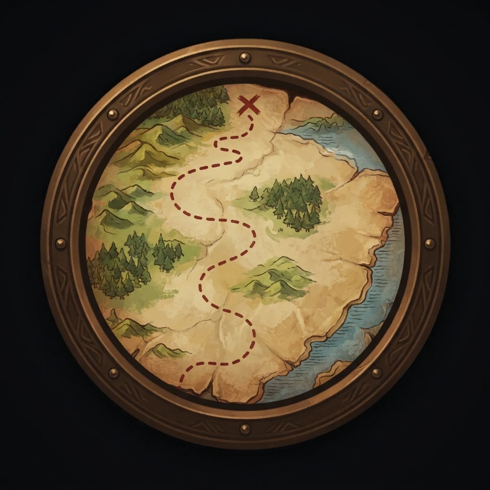

# Passepartout

Passepartout suggests which zone to quest in next in WoW Forever, based on the quests you've done and the ones
still open to you.

## Features

- **Where to go:** zones ranked for your level by the quests you can still do there, the experience they give,
  mob levels, and how far away they are. It also points out outlevelled quests still in your log, dungeons
  worth a group, and zones that open up within a few levels.
- **Journey:** how many quests you've done, and in which zones.
- Updates as you level up, turn in or pick up quests, and move between zones.
- Minimap button, plus an entry in the addon compartment.

## Requirements

[Questie](https://www.curseforge.com/wow/addons/questie) (with QuestieDB). Passepartout reads Questie's quest
database and starts once Questie has finished loading.

## Commands

| Command | What it does |
|---|---|
| `/pp` | Open or close the window |
| `/pp scan` | Re-read your quest history |
| `/pp elite` | Count elite (group) quests or ignore them |
| `/pp minimap` | Show or hide the minimap button |

## License

MIT. See [LICENSE](LICENSE).
